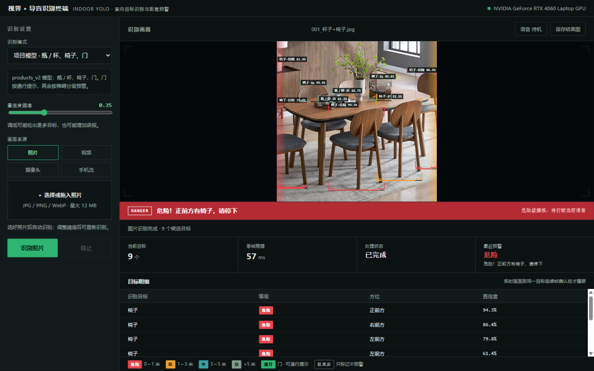
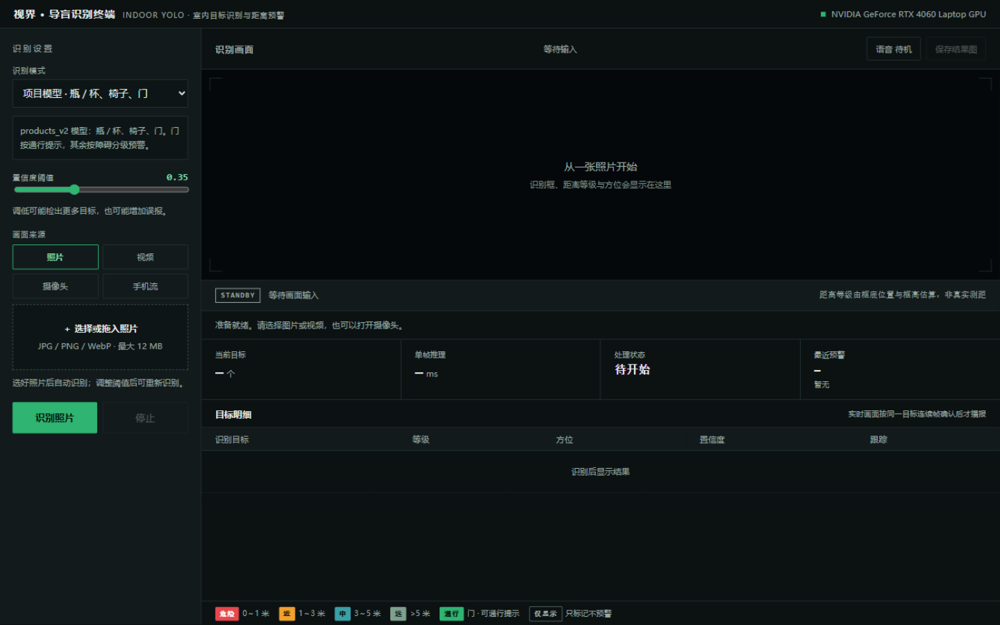
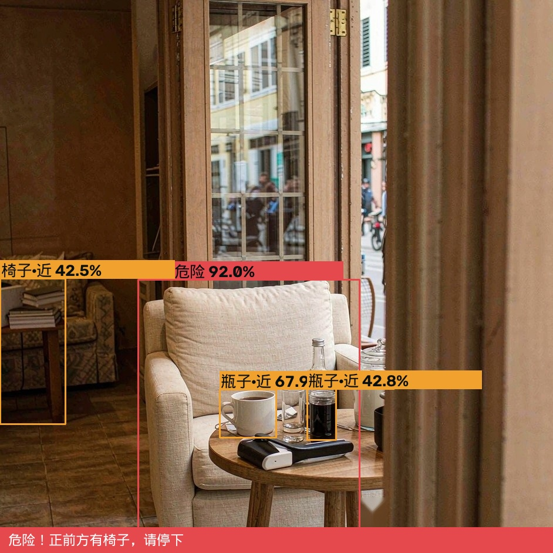

# Assist-Vision Demo · 室内目标识别与距离预警终端

基于 YOLO 的室内目标识别 + 几何距离分级 + 语音预警的本地演示系统，面向视障辅助场景的原型验证。
全部推理在本地完成，**不依赖任何云端接口**。



## 功能特性

- **实时检测**：照片 / 视频文件 / 电脑摄像头 / 安卓手机局域网视频流（MJPEG·RTSP）四种来源
- **距离三级预警**：危险（约 1 米内）/ 近（1～3 米）/ 中（3～5 米），由检测框底边位置与框高占比做几何估算
- **角色语义**：门按"通行"目标提示不报警，瓶/椅/人按障碍物分级，无关类别仅显示不播报
- **同目标连续帧确认**：ByteTrack 跟踪，同一目标连续 2 帧处于预警等级才语音播报，杜绝两个物体各闪一帧凑数误报
- **中文语音播报**：Web 端用浏览器自带语音合成（零依赖），CLI 端可选 pyttsx3；危险级打断当前播报，按等级冷却（2s/4s/8s）+ 全局最小间隔
- **HUD 叠加层**：四角括号框、接近度进度条、左右方位光带、标签防碰撞
- **归档友好**：保存的结果图自动附加时间/模型/阈值/目标数/最近预警元数据条

## 界面

| 初始态 | 识别完成态 |
| --- | --- |
|  |  |

CLI 演示（同一预警引擎）：



## 快速开始

### 环境要求

- Python 3.9+，NVIDIA GPU（可选，CPU 可跑但实时性下降）
- 已验证环境：Python 3.11 + PyTorch 2.5.1 + CUDA 12.1 + ultralytics 8.4.33（RTX 4060 Laptop，单帧推理 44~57ms）

### 安装

```bash
pip install ultralytics opencv-python numpy
# CLI 语音播报（可选）：pip install pyttsx3
```

### 启动 Web Demo

```bash
python web_demo/app.py          # 打开 http://127.0.0.1:8765
# 或双击 web_demo 上一级的 启动Demo.cmd（Windows）
```

### 启动 CLI Demo

```bash
python -m guide_demo.cli_demo --source 0                 # 摄像头实时
python -m guide_demo.cli_demo --source 视频.mp4          # 视频文件
python -m guide_demo.cli_demo --source 图片.jpg          # 单张图片
python -m guide_demo.cli_demo --source 目录 --no-show    # 批量图片调试
```

## 玩法讲解（Web Demo）

1. **选来源**：左侧选择 照片 / 视频 / 摄像头 / 手机流；照片支持拖入，选好自动识别
2. **调阈值**：置信度滑杆 0.05～0.95，调低检出更多但也更易误报
3. **看预警**：舞台下方横幅颜色即预警等级（红=危险 / 琥珀=近 / 绿=通行提示）；
   画面里每个目标带四角框 + 等级标签 + 框底接近度条；左右边缘光带 = 对应方位有目标
4. **听播报**：默认开启（右上按钮可关）；实时画面同一目标连续 2 帧确认才播报，危险级会打断当前语音
5. **存结果**：「保存结果图」导出带元数据条的 PNG，可直接归档
6. **快捷键**：`空格` 开始/停止 · `1-4` 切换来源 · `V` 语音开关

### 距离等级图例

| 徽标 | 等级 | 判定（几何估算） |
| --- | --- | --- |
| 红 `危险` | 0～1 米 | 框底边进入画面下 12%，或框高超过 55% 画面 |
| 琥珀 `近` | 1～3 米 | 框底边进入画面下 1/3，或框高超过 34% |
| 青 `中` | 3～5 米 | 框底边越过画面中部 |
| 灰绿 `远` | >5 米 | 仅显示 |
| 绿 `通行` | — | 门类目标提示，不报警 |
| 描边 `仅显示` | — | 低相关类别（如车辆），只标记不预警 |

> ⚠️ 距离等级来自检测框几何估算（单目、无深度模型），**不是真实测距**。
> 换摄像头或改变安装高度后需重新感受校准；`guide_demo/warning.py` 顶部阈值可调。

## 模型说明

| 模型 | 权重 | 类别 | 用途 |
| --- | --- | --- | --- |
| 项目模型（默认） | `runs/detect/products_v2/weights/best.pt`（未随仓库分发） | bottle / chair / door | 室内场景主模型，YOLO11s 微调 |
| 通用模型 | `models/yolo26n.pt`（ultralytics 官方发布） | COCO 80 类 | 无自训练权重时的兜底 |

权重文件超过 GitHub 单文件限制，未随仓库分发：把 `products_v2/weights/best.pt` 放到
`web_demo/` 上一级的 `runs/detect/products_v2/weights/` 即可；没有权重时也可用任意
YOLO 模型替换（改 `web_demo/app.py` 顶部的 `MODELS` 字典）。

### 用自己的视频训练（第二轮流程）

`scripts/prepare_round2.py` 把标注好的抽帧按**场景（视频级）**划分训练/验证集——
同一视频的所有帧绝不跨集合，并做 SHA-256 查重，避免第一轮"新场景涨、旧场景跌"的教训：

```bash
python scripts/prepare_round2.py \
    --sources 帧目录1 帧目录2 \
    --val-scenes ABC_007 ABC_024     # 强制进验证集的场景键
# 场景键默认匹配 ABC_001_a.jpg 的 ABC_001 前缀，可用 --scene-regex 自定义
```

输出到 `datasets/team_video_round2_<日期>/`（已存在即拒绝，不覆盖旧成果），
含 `data.yaml` 与 `build_manifest.json`（划分依据、类别分布、哈希查重结果）。
设计依据见 [docs/research-notes.md](docs/research-notes.md)。

## 项目结构

```
├── guide_demo/          # 预警管线核心（纯逻辑，零第三方依赖）+ CLI 演示
│   ├── warning.py       #   距离分级 / 方位 / 角色语义 / 连续帧确认 / 冷却打断
│   ├── test_warning.py  #   20 项单元测试
│   └── cli_demo.py      #   摄像头/视频/图片 CLI，pyttsx3 可选
├── web_demo/            # 浏览器 Demo（纯标准库 HTTP 服务 + 单文件前端，无 CDN）
│   ├── app.py           #   服务、推理、ByteTrack 跟踪、预警挂载
│   ├── index.html       #   暗色终端风界面、预警横幅、语音开关
│   └── test_app.py      #   6 项接口与会话测试
├── scripts/
│   └── prepare_round2.py    # 场景级数据集划分（防泄漏）
├── docs/
│   └── research-notes.md    # 距离估计/跟踪/语音/同类项目选型笔记
└── screenshots/
```

## 测试

```bash
python -m unittest guide_demo.test_warning            # 预警管线 20 项
python -m unittest discover -s web_demo -p test_app.py  # 接口与会话 6 项
```

## 路线图

- [ ] 接入 Depth Anything V2（ViT-S metric）把几何分级升级为真实米数
- [ ] 第二轮训练：person 类引入 + 场景级划分复训 + 预警时机评测集（mAP 之外补漏报/误报率）
- [ ] sherpa-onnx 离线神经语音替换 SAPI，提升 CLI 端音质与跨机一致性
- [ ] 手机端直接推理（目前手机只做出流入口，模型跑在电脑端）

## 致谢

- [Ultralytics YOLO](https://github.com/ultralytics/ultralytics) — 检测与 ByteTrack 跟踪
- [Roboflow supervision](https://github.com/roboflow/supervision) — 叠加层设计参考（CornerAnnotator 范式）
- 距离分级方案参考了一个朋友的便携推理原型（几何阈值思路），本仓库在其基础上做了跟踪确认、角色语义与可测试化重写

## 许可证

[MIT](LICENSE)
